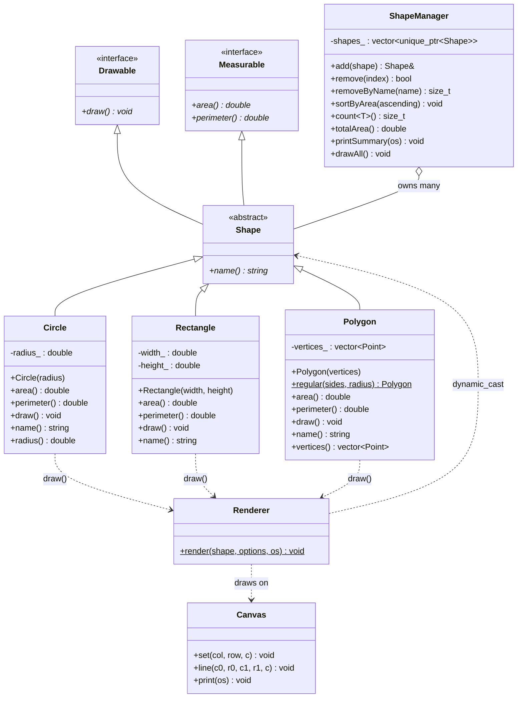

# Shape Geometry Engine

An object-oriented shape engine in **C++17**. It computes the area and perimeter of shapes and draws each one as ASCII art in the terminal, all through one common `Shape` interface.

## Features

- Abstract `Shape` interface (pure virtual `area()`, `perimeter()`, `draw()`, `name()` and a virtual destructor)
- `Circle`, `Rectangle` and `Polygon` (area by the shoelace formula)
- Multiple inheritance: `Shape` inherits from the `Drawable` and `Measurable` interfaces
- ASCII renderer on a character grid; `dynamic_cast` picks shape-specific geometry and captions
- `ShapeManager` to add, remove, sort by area and count shapes by real type
- 47 unit checks covering formulas, errors, sorting and rendering

## Build and run

```bash
make          # builds shape_demo and shape_tests
make run      # runs the demo
make test     # runs the tests
make clean
```

Without make, compile either `main.cpp` or `tests.cpp` (not both, since each defines `main`) together with the other `.cpp` files:

```bash
g++ -std=c++17 -Wall -Wextra main.cpp Canvas.cpp Circle.cpp Rectangle.cpp Polygon.cpp Renderer.cpp ShapeManager.cpp -o shape_demo
```

## Project layout

| File | Purpose |
|------|---------|
| `Drawable.h` | Interface with `draw()` |
| `Measurable.h` | Interface with `area()` and `perimeter()` |
| `Shape.h` | Abstract base: inherits both interfaces, adds `name()` |
| `Circle.h/.cpp`, `Rectangle.h/.cpp`, `Polygon.h/.cpp` | Concrete shapes |
| `Canvas.h/.cpp` | Character grid, Bresenham line drawing |
| `Renderer.h/.cpp` | ASCII rendering with `dynamic_cast` dispatch |
| `ShapeManager.h/.cpp` | Owns a `vector<unique_ptr<Shape>>`; add, remove, sort |
| `main.cpp` | Demo |
| `tests.cpp` | Unit tests |

## UML class diagram



Plain-text version of the same hierarchy:

```
   Drawable        Measurable
   (draw)          (area, perimeter)
       \              /
        \            /
            Shape
           (name)
        /     |      \
   Circle  Rectangle  Polygon

   ShapeManager ---owns many---> Shape
   Renderer --dynamic_cast--> Circle / Rectangle / Polygon
```

## Design notes

- **Why an interface?** Code such as `ShapeManager` works with `Shape&` only. Adding a `Triangle` means writing one new class; nothing else changes (the renderer prints a "no renderer" notice until you add a branch for it).
- **Virtual destructors:** every interface has one, so deleting a derived object through a base pointer is safe.
- **Multiple inheritance without duplication:** `Drawable` and `Measurable` are independent pure interfaces with no data, so there is no diamond and no duplicated code. Any code that only needs measurements can accept a `Measurable&`.
- **`dynamic_cast`:** `Renderer::render` and `ShapeManager::count<T>()` ask at runtime what a `Shape` really is.
- **Aspect ratio:** terminal cells are about twice as tall as wide, so the renderer scales vertical distances by 1/2 to keep circles round.
- **Ownership:** `ShapeManager` stores `std::unique_ptr<Shape>`, so shapes are freed automatically.

## Sample output

Circle, outline (`Shape::draw()`):

```
Circle (r=5)  area=78.54  perimeter=31.42
             *************             
         *****           *****         
      ****                   ****      
    ***                         ***    
   **                             **   
  **                               **  
 **                                 ** 
**                                   **
*                                     *
*                                     *
*                                     *
*                                     *
**                                   **
 **                                 ** 
  **                               **  
   **                             **   
    ***                         ***    
      ****                   ****      
         *****           *****         
             *************             
```

Triangle (polygon), filled with custom characters:

```
Polygon (3 vertices)  area=24.00  perimeter=22.42
                    @                   
                   @#@                  
                 @@###@@                
                @#######@               
               @#########@              
             @@###########@             
            @##############@@           
           @#################@          
         @@###################@         
        @######################@@       
       @#########################@      
     @@###########################@     
    @##############################@    
   @################################@@  
 @@###################################@ 
@@@@@@@@@@@@@@@@@@@@@@@@@@@@@@@@@@@@@@@@
```

Rectangle, filled:

```
Rectangle (12 x 4)  area=48.00  perimeter=32.00
@@@@@@@@@@@@@@@@@@@@@@@@@@@@@@@@@@@@@@@@
@######################################@
@######################################@
@######################################@
@######################################@
@######################################@
@######################################@
@@@@@@@@@@@@@@@@@@@@@@@@@@@@@@@@@@@@@@@@
```

Collection summary, sorted by area:

```
#   Shape               Area     Perimeter
------------------------------------------
0   Polygon            24.00         22.42
1   Rectangle          48.00         32.00
2   Polygon            64.95         30.00
3   Circle             78.54         31.42
------------------------------------------
Total area            215.49
```

The full demo output is in `sample_output.txt`.

## Tests

`make test` prints `47/47 checks passed`. The tests cover:

- Known values: circle r=1 gives pi; a 3x4 rectangle gives area 12 and perimeter 14; a 3-4-5 triangle gives area 6 and perimeter 12; an L-shaped polygon gives area 12
- Shoelace result is the same for clockwise and counter-clockwise vertex order
- Invalid input (zero or negative sizes, fewer than 3 vertices) throws `std::invalid_argument`
- Use through `Measurable*`, `Drawable*` and `Shape*` pointers
- Manager add, remove, sort (both directions), type counts and error cases
- Renderer output, including the fallback for an unknown shape type

## Extending

To add a new shape, derive from `Shape`, implement the four functions, and add one `dynamic_cast` branch in `Renderer::render`.
